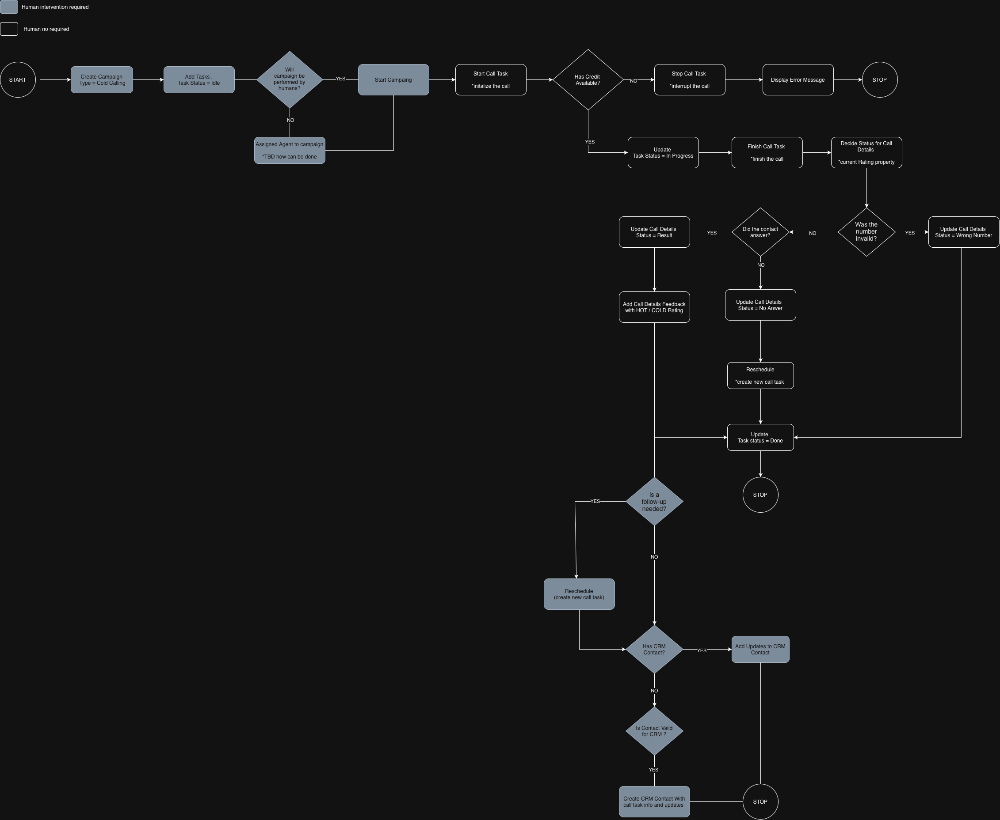

# NexCall backend updates

## ~~Update #1: Introduce the APIs required for the Settings section~~

**Status: Implemented**, as confirmed by product. Retained below as the original requirements; the current API contract takes precedence over historical examples.

### Context

The Settings UI currently has no persistent backend data. Industry classifiers are read from bundled JSON files, while the Twilio-number inventory is supplied by an in-memory HTTP interceptor and is reset on browser reload. The backend must replace those prototypes with persistent APIs; the UI will move to the resulting classifier contract.

### Goal

Provide persistent, authorized CRUD APIs for:

- standardised industry classifications;
- NexCall's existing Twilio calling-number inventory and its tenant assignment;
- returning the calling numbers that a user may select for a campaign.

This is inventory management only. It does not buy, provision, release, or reconfigure numbers in Twilio.

### Details

#### Industry classifiers

Canonical resource: `/api/settings/industry-classifiers`. Each classifier is one standardised entry:

```json
{ "code": "6210", "description": "Custom software development", "standard": "CAEN_REV3" }
```

`standard` identifies the published classification set, including its version; for example, `CAEN_REV3` and `NAICS_US_2022`. `code` remains a string so leading zeroes are preserved. The combination of `standard` and `code` is unique.

| Request | Purpose |
| --- | --- |
| `GET /api/settings/industry-classifiers` | List classifiers; `standard` is an optional query parameter. |
| `GET /api/settings/industry-classifiers?standard=CAEN_REV3` | List classifiers in one standard. |
| `POST /api/settings/industry-classifiers` | Create `{ code, description, standard }`. |
| `GET /api/settings/industry-classifiers/{standard}/{code}` | Read one classifier. |
| `PATCH /api/settings/industry-classifiers/{standard}/{code}` | Update its description. |
| `DELETE /api/settings/industry-classifiers/{standard}/{code}` | Delete an unreferenced classifier. |

Seed the existing CAEN Rev. 3 and NAICS US 2022 data, and make this resource the single source of truth for Settings and CRM. Reject duplicate entries and prevent deletion of entries used by CRM records. The current UI catalog routes will need to move to this simplified contract; no separate CRM-owned classifier data should be created.

#### Twilio-number inventory

Base resource: `/api/settings/twilio-numbers`.

| Request | Purpose |
| --- | --- |
| `GET /api/settings/twilio-numbers` | List accessible inventory records. Supports `tenantId`, `availableToTenantId`, and `includeUnassigned` filters. |
| `POST /api/settings/twilio-numbers` | Create an unassigned number: `{ phoneNumber }`. |
| `GET /api/settings/twilio-numbers/{id}` | Read one record. |
| `PATCH /api/settings/twilio-numbers/{id}` | Update the phone number: `{ phoneNumber }`; do not change its assignment. |
| `DELETE /api/settings/twilio-numbers/{id}` | Delete an unassigned record. |
| `PATCH /api/settings/twilio-numbers/{id}/tenant` | Assign or release a number: `{ tenantId, expectedTenantId }`. `tenantId: null` releases it. |

Return the same shape for each inventory record:

```json
{
  "id": 1,
  "phoneNumber": "+19069702512",
  "tenantId": null,
  "tenantName": null
}
```

`phoneNumber` must be normalized as an international E.164 number and unique. A number can belong to zero or one tenant; a tenant can have multiple numbers. Resolve `tenantName` from the tenant record rather than accepting it from the client.

Platform administrators may create, edit, delete, assign, and release inventory records. Tenant users may read and use only numbers assigned to their tenant. Platform administrators may also use an unassigned pool number for a campaign. Enforce these rules on the server; UI guards and query parameters are not authorization.

Treat assignment as an atomic update. `expectedTenantId` represents the assignment the client last saw; return `409 Conflict` if it has changed. Also return `400` for invalid phone numbers or assignments, `404` for missing numbers or tenants, and `409` for duplicate numbers or attempts to delete an assigned number.

The existing campaign `twilioNumber` value must remain compatible. On campaign create or update, validate that the selected number is in the inventory and is eligible for that campaign's tenant and caller. Do not retroactively rewrite existing campaigns or live calls when an inventory record changes.

## ~~Update #2: Extend customers (tenants) with billing info and Twilio numbers~~

**Status: Implemented**, as confirmed by product. Retained below as the original requirements; the current API contract takes precedence over historical examples.

### Context

The UI now calls customers **tenants**, but it continues to use the existing `/api/customers` API. Its tenant data is currently mock-backed and has basic contact fields plus optional demonstration billing data. The backend must make this information persistent and expose the Twilio numbers allocated to each tenant.

### Goal

Extend the existing customer resource so it represents a tenant with required contact and billing information. Keep `/api/customers` as the API path and existing customer operations intact. Make each tenant's assigned Twilio numbers visible and manageable through the Settings inventory introduced in Update #1.

### Details

#### Customer / tenant data

Continue using `/api/customers`; use **tenant** in Swagger titles, descriptions, and user-facing documentation. Existing client integrations may still use the customer name and URL.

Each tenant must have these required fields:

```json
{
  "name": "Example Tenant",
  "address": "1 Example Street",
  "email": "admin@example.com",
  "phoneNo": "+40123456789",
  "billingDetails": {
    "entityName": "Example Tenant SRL",
    "businessId": "RO12345678",
    "tradeRegistryId": "J40/123/2026",
    "bankAccount": "RO00BANK0000000000000000",
    "bankName": "Example Bank",
    "websiteUrl": "https://example.com"
  }
}
```

`billingDetails` is required, and all fields shown above are required. Validate email, phone number, URL, and non-empty billing values on create and update. Return the complete `billingDetails` object in customer list and detail responses. Existing tenants without billing data must be migrated or completed before they can be treated as valid tenants.

Keep the current customer CRUD endpoints and payload conventions:

| Request | Purpose |
| --- | --- |
| `GET /api/customers` | List tenants. |
| `POST /api/customers` | Create a tenant with required contact and billing data. |
| `GET /api/customers/{id}` | Read a tenant, including billing data and assigned Twilio numbers. |
| `PATCH /api/customers?customerId={id}` | Update contact and billing data. |
| `DELETE /api/customers/{id}` | Delete a tenant only when related data, including assigned numbers, has been handled safely. |

#### Assigned Twilio numbers

A tenant can have multiple Twilio numbers; a number can have at most one tenant. Do not add a single `twilioNumber` column to the customer record. The number inventory and ownership relationship remain owned by the Settings API from Update #1.

Include an `assignedTwilioNumbers` array in the customer detail response, using the existing number shape:

```json
"assignedTwilioNumbers": [
  { "id": 1, "phoneNumber": "+19069702512", "tenantId": 42, "tenantName": "Example Tenant" }
]
```

To add, reassign, or release a number for a tenant, use `PATCH /api/settings/twilio-numbers/{id}/tenant` with `{ tenantId, expectedTenantId }`. The server must validate that the tenant exists and perform the change atomically. Do not delete a tenant while numbers are assigned; require those numbers to be released or reassigned first.

## ~~Update #3: Update CRM to use industry classifiers~~

**Status: Implemented**, as confirmed by product. Retained below as the original requirements; the current API contract takes precedence over historical examples.

### Context

CRM accounts currently use mock industry values. The industry must instead be selected from the standardised classifier data introduced in Update #1, so the code and description are consistent across CRM records.

### Goal

Allow each CRM account to be classified by an industry standard and code. The backend must validate the selection against the Settings classifier API and return the matching description.

### Details

Add these fields to the CRM account create, update, and read contracts:

```json
{
  "industryStandard": "CAEN_REV3",
  "industryCode": "6210",
  "industryDescription": "Custom software development"
}
```

Clients provide `industryStandard` and `industryCode`. The server verifies that the pair exists in `/api/settings/industry-classifiers`, then resolves and returns `industryDescription`; clients must not set the description themselves. Reject an unknown or mismatched standard/code pair with `400 Bad Request`.

Keep the classification fields on CRM accounts, not on contacts. The CRM UI can query `GET /api/settings/industry-classifiers?standard={standard}` to populate the industry selector. Existing mock-only classifier fields (`industryClassifierId`, `industryClassifierName`, and `industryVersion`) should be replaced by this simpler standard-and-code contract.


## Update #4: Expose call-recording availability before playback

### Context

Twilio recordings arrive asynchronously after a call. Opening a player only to report that no recording exists is misleading. Availability belongs in the call-task response so the campaign table can represent it before the user clicks Listen.

### Goal

Disable and grey out Listen for a phone number whose latest attempt has no playable recording. Show the translated tooltip “Call recording not yet processed”. Open the player only when a recording is available.

### Implementation

- Include `recordingAvailable: boolean` in each call-task phone-number projection. Do not expose recording credentials or URLs merely to render the table.
- Compute availability for the latest attempt for that phone, not an older attempt or another phone on the task.
- Return `false` when there is no attempt, no recording URL, a blank URL, or recording status is `IN_PROGRESS`. Preserve compatibility with existing recordings that have a URL but no recording status.
- The UI treats a missing flag as unavailable, applies the same rule on desktop and mobile, and prevents disabled actions from opening a modal. The tooltip must remain accessible on the disabled control's wrapper.
- Refresh availability when tasks reload after Twilio processing. Do not claim real-time readiness without a corresponding refresh/event mechanism.
- Verify no-attempt, pending, available, legacy recording, newest-attempt and selected-phone scenarios.

**Status:** Implemented in the local API and web changes; deployment and a live Twilio processing check remain to be verified.

## Update #5: Campaign-specific calling flow — Cold Calling and Collections

### Context

Cold Calling and Collections have different outcomes and progression. The operator must follow the type of campaign returned by the API, rather than reuse Collections dispositions for every call. The supplied “Next Call Flow” diagram describes the desired cold-calling journey, including qualification, follow-up tasks and CRM updates.



Rename the product label “Debt Recovery” to **Collections** throughout the web interface, examples and product documentation. Keep the current API/database value `DEBT_RECOVERY` until an explicitly coordinated backend migration changes it. Cold Calling remains `COLD_CALLING`.

### Goal

Provide a campaign-aware operator flow that follows the server contract, keeps task lifecycle, call disposition and lead qualification distinct, and preserves Collections behavior. The backend owns task transitions and retry eligibility; the client must not simulate them by changing local task status or submitting duplicate tasks.

### Implementation

#### Current API contract and diagram mapping

Reviewed against the API source on 7 November 2026. These are local-source findings, not confirmation of a deployed API version.

| Concept | Diagram / product wording | Current API behavior |
| --- | --- | --- |
| Campaign type | Collections / Cold Calling | `DEBT_RECOVERY` / `COLD_CALLING`. |
| Task lifecycle | Idle → In progress → Done | `IDLE`, `ACTIVE`, `DONE`; the diagram’s “In progress” maps to `ACTIVE`, not a new enum value. |
| Invalid number | Wrong number | `WRONG_NUMBER`; a cold-call task becomes `DONE`. |
| Unanswered call | No answer → create successor → original done | `NO_ANSWER` currently returns the **same task to `IDLE`**. This differs from the diagram. |
| Answered call | Result | The API enum has `RPC_RESULT`, not `RESULT`. Use the label “Result” for cold calling with the existing wire value. |
| Lead qualification | Hot / Cold | Separate `qualification: HOT | COLD`, accepted only for answered cold-call outcomes. Currently optional on the backend. |
| Collections outcomes | Existing collections flow | Preserve `RPC_RESULT`, `LMV`, `LMP`, `UNRESOLVED`, `NO_ANSWER`, `WRONG_NUMBER` and existing task-transition rules. |

The backend currently also accepts `LMV`, `LMP` and `UNRESOLVED` as answered cold-call outcomes. The diagram's cold-calling UI should offer Result, No answer and Wrong number; continue to render historic API outcomes without losing their meaning. Do not globally rename enum values or rewrite historic data.

#### Next-call selection and attempt identity

- Call `GET /api/operator/callTask/next` without `callType`, `campaignType` or `crmCapable` parameters, as requested by the backend team. Use the returned `campaignType`, campaign/task identifiers and `contactId` to determine the UI and available actions.
- Generate a fresh UUID `attemptKey` for each new cold-call or CRM-linked outbound attempt, pass it when connecting through Twilio, and retain it for disposition retries. Retries of the same operation must reuse the key.
- Capture the numeric `callDetailsId` from `GET /api/campaigns/{campaignId}/callTasks/{taskId}/conferences` while the attempt is active. Retain the campaign, task and attempt IDs for subsequent attempt-scoped actions; do not infer an attempt ID from the task ID.
- Keep incoming calls, Collections scripts, conference participation, disconnect/cancel/error handling and authorization intact. Delayed or repeated SDK/WebSocket events must not open duplicate feedback dialogs or attach feedback to a newer attempt.

#### Cold-calling progression

1. Create a Cold Calling campaign and add prospect tasks in `IDLE`. Start the campaign using existing authorized operations. The diagram's automated-agent assignment is explicitly TBD and must not be presented as implemented.
2. Start the selected call. Credit eligibility and actual task transitions are server responsibilities. Show a translated error if the API/provider rejects the call; do not manufacture a successful connection or disposition. The credit-check contract must be confirmed before adding new credit-specific UI.
3. After the call ends, collect a cold-calling outcome. For Result, allow HOT/COLD qualification and feedback. For No answer or Wrong number, omit qualification.
4. Submit `PATCH /api/campaigns/callTasks/callDetails/status` with the attempt identity, `callStatus`, feedback and applicable qualification. Show saving state; retain the form and error on failure. Proceed to post-call actions only after successful disposition.
5. For answered calls, offer an optional follow-up. The current API requires the original task to be `DONE`, the provider call to be `COMPLETED`, and the campaign to remain active. A future schedule must not exceed campaign expiration. A delayed provider callback can temporarily prevent follow-up; allow retry without re-submitting a different disposition.
6. If a CRM contact is linked, allow an additional contact update. If no contact is linked, offer explicit prospect promotion when appropriate, then use the returned contact ID. Do not automatically promote every prospect or duplicate the disposition update already generated by the backend.
7. Preserve failed post-call inputs and allow independent retries. A completed follow-up must not be created again just because a subsequent CRM action failed.

#### Existing post-call APIs

All paths below are relative to `/api/campaigns/{campaignId}/callTasks/{taskId}/attempts/{attemptId}`. Preserve tenant and operator ownership checks server-side; these endpoints do not grant operators unrestricted access to CRM pages.

| Request | Payload and behavior |
| --- | --- |
| `POST /follow-up` | `{ scheduledAt }` in UTC, formatted `dd/MM/yyyy HH:mm`. Creates a successor for an answered, finalized call. Repeating the same attempt/date returns the existing successor; conflicting schedules are rejected. |
| `POST /crm-update` | `{ text, channel }`, with a stable `Idempotency-Key` for retries. Requires an answered finalized call and a linked CRM contact. |
| `POST /promote-to-contact` | No body. Creates/links a CRM contact from the completed prospect, returns `contactId`, and preserves finalized call history. Retry the same attempt safely. |

Use operation-specific NgRx Request / Success / Failed actions for disposition, follow-up, promotion and CRM updates. Each operation needs its own loading/error state and translated errors. Keep HTTP calls in services and progression in domain effects/containers.

#### Differences requiring backend alignment

- **Task status naming:** “In progress” in the diagram is the API’s `ACTIVE` task status. Do not send `IN_PROGRESS` as a task status.

- **Unanswered retry:** the diagram requires a new successor and closes the original. Current `CallDetailsService.applyOperatorDisposition` returns the same task to `IDLE`, and `ColdCallingActions.schedule` rejects unanswered attempts. Until the backend contract changes, preserve the current retry behavior. To adopt the diagram, implement successor creation atomically and idempotently on the backend and specify retry timing; do not call the answered-only follow-up endpoint for `NO_ANSWER`.
- **Result naming:** `RESULT` is a display concept, not a supported API enum. Use `RPC_RESULT` unless the backend adds a compatible replacement.
- **Qualification:** the diagram includes HOT/COLD; the API currently permits an omitted qualification. Confirm whether it must become mandatory before tightening server validation.
- **Credit checks and automated agents:** the diagram alone does not specify endpoints, failure codes, reservations or agent allocation. Confirm those contracts separately rather than inventing client-side behavior.

#### Acceptance checks

- Collections labels appear throughout the web UI, while requests retain `DEBT_RECOVERY`.
- Next-call requests send no campaign/call-type filters; the returned campaign determines scripts and dispositions.
- Cold-calling Result, Wrong number and No answer use the correct API values and server-provided task state. Collections behavior remains unchanged.
- HOT/COLD cannot be submitted for unanswered/wrong-number outcomes or Collections calls.
- Duplicate disconnects, delayed callbacks, save failures and retry requests do not lose feedback, finalize another attempt or create duplicate successors/CRM updates.
- Answered calls support follow-up, linked-contact updates and explicit prospect promotion with tenant isolation and server authorization enforced.
- Pending recording icons follow Update #4.

**Status:** Planned integration and backend alignment. The Collections web terminology change is implemented; the complete diagram flow is not marked delivered. Resolve the unanswered-call mismatch before claiming parity with the diagram.


### Web integration progress — 9 November 2026

The operator feedback dialog now receives the selected campaign type: Cold Calling offers Result (`RPC_RESULT`), No answer and Wrong number; Collections retains all six legacy dispositions. Answered outbound cold calls can send optional HOT/COLD qualification with the original attempt key. Qualification is omitted for other outcomes and for Collections. Cold-call feedback is limited to the API's 1,000 characters.

Single call-task forms now use two full-width steps: required first name, last name and primary phone, then optional details. CRM contact email is on its second step. These changes do not mark the complete follow-up/CRM diagram implemented; the unanswered retry mismatch documented above remains unchanged.

### Answered-call rescheduling and task lifecycle — 9 November 2026

Call-task tables show the server's task lifecycle (`IDLE`, `ACTIVE`, `DONE`) as a mandatory Task status column. A completed task cannot be edited; the Edit action is omitted on desktop/mobile and guarded in the campaign editor.

The outbound Cold Calling Result dialog supports **Reschedule agreed** with an optional local date/time. The frontend resolves the exact attempt before saving disposition, then schedules a successor through the existing attempt-specific follow-up endpoint. Date/time is converted to the API's UTC format. Follow-up scheduling has separate request/success/failed actions, loading state and a retry panel; a failed scheduling request does not re-submit the completed call's feedback.

**Backend limitation:** the existing endpoint requires a future `scheduledAt` within campaign expiry, an active campaign, a finalized answered outbound attempt and completed Twilio processing. Undated agreements remain explicitly pending in frontend session memory only, with a date entry and schedule action; they are lost on reload and are not represented as server-scheduled tasks. Persisting an undated agreement requires a backend contract extension. Delayed Twilio processing can require a retry. No-answer remains the existing automatic IDLE retry path; this change does not implement the remaining CRM/diagram branches.

### Campaign staff assignment — 9 November 2026

Operators and Closers panels retain their allocated members and expose role-specific Assign buttons. The searchable picker lists staff linked to the campaign's tenant, marks existing allocations and stays open for multiple additions. Saving disables repeat submissions; errors remain visible and successful assignments refresh the matching panel.

The API now accepts `POST /api/campaigns/{campaignId}/users/{userId}` (204). Admins and the tenant's administrators may assign eligible tenant-linked operators or closers to that campaign. The service locks the campaign, validates tenant membership and role, and treats duplicate assignment as a no-op without reactivating suspended allocations. It does not link staff to a tenant or modify other campaigns. Deploy/restart the updated API before using the new action.

### Cold-call outcome dialog — 9 November 2026

The operator starts with two large choices: Result and No result. Result uses the API's `RPC_RESULT` outcome and requires Hot/Cold qualification for outbound calls; notes are optional and follow-up/rescheduling remains available. No result offers No Answer or Wrong Number with no notes requirement or rescheduling fields. Switching branches clears the prior branch's values. Collections retains its existing disposition and required-notes behavior. Incoming calls retain the existing API restriction on qualification.

### Call details, CRM authors and follow-up identity — 9 November 2026

CRM update list/detail responses resolve missing author names using the stored author ID, preserving manual authors and calling operators. The update table shows call outcome, or “Update added” for manual updates. Details stack vertically without redundant internal dividers.

Campaign task rows are selectable and load `GET /api/campaigns/{campaignId}/callTasks/{callTaskId}` into the right panel. The response contains `task` and newest-first `attempts`, including outcome, qualification, operator email and notes. Tenant authorization and task/campaign identity are checked before returning details; Twilio secrets and recording URLs are not exposed.

The disposition PATCH now returns `{callDetailsId}` for the exact saved attempt. Follow-up scheduling uses this ID after saving the outcome and no longer calls `/conferences`. Older APIs that omit the ID leave the agreement pending with an explicit compatibility message; they must be updated to enable scheduling. Result and No result buttons each fill their own row. These API changes require deploying/restarting the updated backend.

### Save campaign prospects to CRM — 9 November 2026

Cold-calling campaign task tables expose left-side selection and a **Save to CRM** action for administrators and tenant administrators when CRM is enabled. Select up to 100 prospects, including uncalled tasks. Active calls and tasks already linked to CRM cannot be selected. Confirmation stays open while saving; failures preserve the selection for retry, and success clears the saved selection and reloads the task list.

The new endpoint is `POST /api/campaigns/{campaignId}/callTasks/save-to-crm`, accepting `{"taskIds":[1,2]}` and returning `{"items":[{"taskId":1,"contactId":10}]}`. The backend validates campaign/tenant ownership and cold-calling type, locks tasks and persists CRM contacts and task links in one transaction. Repeating a saved task returns its existing contact instead of creating another. An eligible unstarted follow-up is linked too; a conflicting follow-up rejects the transaction. Finalized outbound call history is queued through the CRM outbox using the original operator identity.

Deploy/restart the updated API to enable this action. Automated service, state, HTTP and confirmation tests cover the change; live end-to-end persistence remains to be verified against the running API.

### Cold-calling disposition handoff — 9 November 2026

The operator retains the Result / No result dialog. Choices are not gated by provider readiness and no disposition polling is performed. The backend validates the chosen outcome against the calling provider; a conflict is explained in a translated toast while the dialog stays open with all entries preserved for correction or retry. Call-report and rescheduling confirmations/errors use toasts rather than inline report banners or an operator-page status panel.

For outbound cold calls, Result maps to DONE, or RESCHEDULE when Reschedule agreed is checked. Reschedule requires a callback date and sends it as dd/MM/yyyy on the existing status PATCH, using the same dial attemptKey. No Answer and Wrong Number remain available under No result. Hot/Cold is optional. Collections is unchanged. These outcomes do not create separate follow-up tasks.

The backend owns callback date validation and queue ordering. Pending callback dates and Done/Rescheduled outcomes are displayed in the UI. The updated status PATCH requires the backend handoff implementation; no live Twilio verification is claimed.

### Duplicate campaigns instead of replay — 9 November 2026

Replay is removed from campaign details. Administrators and tenant administrators can duplicate a campaign from its list-row action. Confirmation stays open while saving and after failure. Success opens the new campaign.

The Duplicate action uses the existing replay endpoint: `PATCH /api/campaigns/{campaignId}/redeploy` with a null body. It opens the campaign ID returned in the response. The backend owns copy naming, task creation and all duplication defaults. The UI does not call `/duplicate` or send a name/idempotency key. Request IDs in UI state only correlate responses with the open dialog.

The local API checkout still implements the old redeploy behavior (reactivating the source campaign); deploy the backend team's revised replay implementation for independent campaign copies. Do not assume retries are idempotent without that backend guarantee.


Deploy/restart the updated API before using duplication in Dev. Existing replay API compatibility remains, but no campaign Replay button is exposed.

### Campaign task CRM handoff — 9 November 2026

Save selected tasks with `POST /api/campaigns/{campaignId}/callTasks/save-to-crm` and `{taskIds: [...]}` (1–200 IDs). The response has `savedTaskIds`, `duplicateTaskIds`, and `failedTasks` with per-task translation keys. HTTP 200 may include partial or complete failure; successful entries commit independently. Show non-empty outcome groups in separate toasts, without raw task IDs or inline result banners; retain unsaved selections and refresh the current task page. Unknown per-task messages use a localized generic fallback.

Task CRM indicators use `linkedToCrm` and `hasCrmAccount`, never snapshot account IDs/names. Standalone contacts are linked without a company account. The shared task-table gallery includes these indicators in both variants.

The task detail panel loads attempts through `GET /api/campaigns/{campaignId}/callTasks/{callTaskId}/callDetails?page=0&pageSize=20`, with pagination, stable `callDetailsId` keys, API-formatted dates, and recording playback when `recordingUrl` is present. Task identity/details come from the selected list row. No backend implementation changes are required by this web handoff.

### CRM contact links and call attempt cards — 9 November 2026

Tasks with an active CRM link and a returned `contactId` expose a contact link in the task table and inspection panel. Links open `/app/crm/contacts/{contactId}` and carry the campaign customer scope; administrators resolve that scope against their authorized tenant list before loading CRM data. Missing IDs remain plain status text. Clicking a link does not select the task row.

Task inspection presents each call attempt in a separate card with date, outcome, phone, duration, optional caller/type/qualification, feedback and optional recording. Task fields are expandable so attempts are immediately visible. Existing history pagination and retry behavior are retained.

The call-task table now has a single **CRM** column; the company-account column is removed. “Saved to CRM” opens the linked contact. Contact detail routes fetch the requested ID directly with `[CRM] Load Contact / Success / Failed`, so navigation does not depend on the contact being included in the loaded list. Scope changes cancel pending detail requests.

### Tenant Dashboard availability — 9 November 2026

Dashboard is hidden for tenants (`CLIENT_ADMIN`) and remains available to platform administrators. A route gate redirects tenant Dashboard visits to Campaigns before loading the Dashboard package, including the default `/app` landing path.
